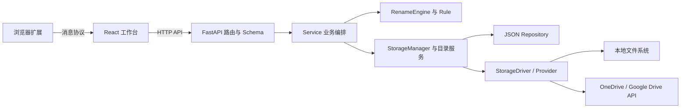

# 系统架构

[文档索引](README.md) · [开发行为规范](../AGENTS.md) · [前端架构](frontend/ARCHITECTURE.md) · [后端架构](backend/ARCHITECTURE.md) · [API](api/README.md)

章节：[系统地图](#系统地图) · [模块与依赖](#模块与依赖) · [核心流程](#核心流程) · [业务与安全不变量](#业务与安全不变量) · [能力边界](#能力边界)

## 系统地图

Rename Studio 将文件浏览、规则组合、预览校验与真实改名分开。浏览器负责交互与状态展示；Python 后端负责名称转换、校验、连接生命周期和写入；Provider 封装本地文件系统或第三方云盘差异。

图展示主要业务调用，服务装配与 Provider 注册见[后端架构](backend/ARCHITECTURE.md#依赖与对象装配)。扩展消息只请求导航，详见[扩展架构](browser-extensions/ARCHITECTURE.md)。

## 模块与依赖

| 模块 / 代码入口 | 负责 | 边界 |
| --- | --- | --- |
| [前端工作台](../frontend/src/WorkspaceApp.tsx) | 布局、导航与 Hook 协调 | 不重复实现后端重命名规则或结果判定 |
| [API](../backend/app/api)、[Schema](../backend/app/schemas) | HTTP 契约、输入输出、依赖注入 | 不承载核心业务算法 |
| [Service](../backend/app/services) | 预览、执行、连接、授权与目录流程 | 跨 Provider 依赖统一接口，避免类型分支复制业务 |
| [Rule](../backend/app/rules)、[RenameEngine](../backend/app/services/rename_engine.py) | 按规则顺序转换文件名 | 不访问文件系统或云盘；顺序由输入决定 |
| [Provider](../backend/app/providers)、[StorageDriver](../backend/app/providers/base.py) | 配置、认证、存储读写和名称约束 | 不实现重命名规则，不向 UI 泄露供应商细节来决定业务状态 |
| [Repository](../backend/app/repositories/storage_repository.py) | 状态加载与原子保存 | 不承担业务决策 |
| [发布入口](../backend/app/release.py)、[启动器](../backend/app/launcher.py) | 预构建 WebUI 与 API 服务生命周期 | 发布包使用单进程，源码开发使用独立开发入口 |

前端与后端通过 [HTTP 契约](api/README.md)协作；扩展与本体通过浏览器消息协作，模块边界和消息语义见[扩展架构](browser-extensions/ARCHITECTURE.md)，精确载荷由其链接的双方类型与校验器维护。HTTP 字段、错误码和结果枚举见 API 文档。

### 状态放在哪里

| 状态 | 所属位置 | 生命周期 |
| --- | --- | --- |
| 连接配置、凭据、应用偏好 | 后端 [StorageManager](../backend/app/services/storage_manager.py) + JSON Repository | 保存到本地状态文件，路径由[配置](../backend/app/core/config.py)决定 |
| 预览快照、执行进度、连接互斥、目录缓存 | 后端进程内服务 | 单进程内共享，重启后清空；执行前实时复核源状态 |
| 服务端数据与查询缓存 | 前端 TanStack Query | 页面内存；隔离连接、revision 与目录上下文 |
| 选择、规则、最近修改记录、待核对信息 | 前端 [Zustand Store](../frontend/src/stores/useRenameStore.ts)与工作流 Hook | 页面内存；不同状态有独立清理时机 |
| 当前连接与各连接最后成功位置 | 前端 [workspaceSession](../frontend/src/workspace/workspaceSession.ts) | 标签页 sessionStorage，绑定 revision 与账号；不保存凭据或执行结果 |

## 核心流程

### 浏览目录

工作台读取 Provider 能力、连接与必要的授权状态，恢复有效位置后查询目录。后端通过目录服务和驱动返回规范位置、完整子项及面包屑；云盘分页由驱动聚合，前端再做排序、筛选与虚拟化。[目录 API](api/directories/list.md)定义刷新参数，[后端目录读取模式](backend/ARCHITECTURE.md#目录读取与缓存)说明缓存边界。

### 批量预览与执行

1. 前端从完整目录中取得当前有效选择，按当前排序发送有序文件 ID 与规则链。
2. `PreviewService` 读取源项与同目录项，调用 `RenameEngine`，校验可改名能力、名称合法性和冲突，保存绑定连接 revision 的快照；预览不写真实文件。
3. 用户确认后，前端只提交服务端签发的 `preview_id`。`ExecuteService` 在互斥保护中实时读取目录子项、重新评估，与快照逐项比较；失败时明确尚未开始写入。
4. 复核成功后消费快照，通过 Provider 分组执行并收集逐项结果；成功项保留，不自动回滚。前端合并确认的文件身份并展示结果，进度查询只读。

契约见[创建预览](api/previews/create.md)、[执行预览](api/executions/execute.md)和[执行结果](api/executions/index.md#execution-outcomes)。

### 单项快速改名

唯一选中项通过 Dialog 提交文件身份、原名、完整目标名、位置和 revision。`SingleRenameService` 使用同一连接互斥保护，直接调用驱动；不创建批量预览、不复用批量复核，不读取整个目录或比对原名。具体检查由请求模型、统一服务与驱动按[单项契约](api/executions/single.md)负责。提交会使已有批量预览失效。

### 不确定写入的核对

后端优先按文件 ID 读取元数据确认目标名，不重放写入；仍无法确认则保留未知结果，批量调度停止继续补组，并等待已提交写入收尾。前端将待核对信息与选择、预览分开保存，切换目录时继续保留保护。回到原连接、原目录并强制读取成功后才解除前端门控，旧请求不重放。浏览器整页刷新会清空这些内存记录；刷新页面后，应回到原目录核对真实文件。

## 业务与安全不变量

- 预览不修改真实文件；批量执行必须在写入前实时复核源状态、规则结果、合法性与冲突。
- 单项与批量遵守各自契约，分别管理预览与执行状态；单项的原名字段用于上下文，服务端按 ID 直接执行。
- 结果区分成功、失败、部分完成与未知；逐项状态和汇总依据 [API](api/executions/index.md#execution-outcomes)，不从消息、进度完成或显示名称推断。
- 未知写入不推断成功、不盲目重试；核对、取消收尾与连接互斥保护不可绕过。
- 连接配置、revision、账号身份和执行互斥共同约束操作；旧连接、旧账号和迟到响应不得污染当前工作区。
- 文件 ID 是资源身份，`StorageLocation` 是位置对象，路径是浏览/展示上下文；Local 改名后 ID 可能改变，云盘 ID 不得当作路径解析。见[位置](api/common/locations.md)与[文件元数据](api/common/files.md)。
- 访问/刷新令牌及密钥不得进入日志、公开响应或版本控制；状态文件包含未加密凭据，不能随发布包分发。
- API 字段、错误码、结构化结果是跨端契约，变更时同步调用方、类型、测试和负责该主题的文档。

## 能力边界

支持 Local、OneDrive 个人版和 Google Drive 我的云端硬盘，规则能力由[规则 API](api/rules/index.md)定义。选中文件夹只改其自身名称，不递归改内容。当前没有持久化改名历史、撤销/重做或规则集 UI。

开发时 Vite 代理 `/api`；发布时单进程提供预构建静态资源、根路径 API 和 `/api` 挂载。进程内状态不支持多 worker 部署。环境搭建见[开发环境](DEVELOPMENT.md#环境与开发启动)，发布边界见[启动说明](LAUNCHER.md)与[发布流程](DEVELOPMENT.md#发布流程)。
