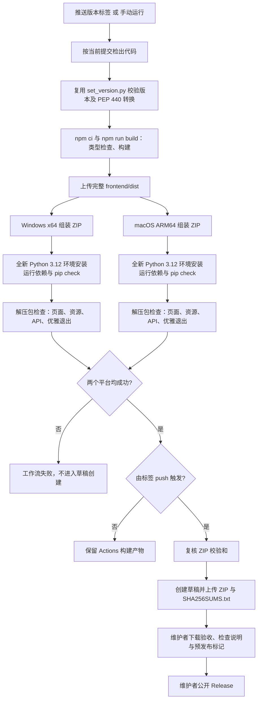

# ZIP 构建与版本发布

## 发布约定

- Git 标签和 ZIP 使用 `v1.0.0-alpha2`；前端和 FastAPI 使用 `1.0.0-alpha2`；Python 包使用 PEP 440 规范形式 `1.0.0a2`。统一由 `scripts/set_version.py` 转换与检查，不直接比较两种形式的字符串。
- 支持正式版、`alphaN`、`betaN` 和 `rcN`。本轮为内测版，后续可递增为 `v1.0.0-alpha3`；正式发行使用 `v1.0.0`。已公开版本不覆盖、不移动标签。
- 首批检查平台为 Windows x64（`windows-2022`）和 macOS ARM64（`macos-15`），Python 3.12。运行环境不随 ZIP 分发，用户需预装 Python，首次启动联网安装依赖。其他平台、架构、Python 版本及更旧的桌面系统尚需另行验收。
- 推送 `v*` 标签触发 `Release ZIPs` 工作流。全部检查成功后创建 **Release 草稿**，由维护者最后公开；带预发布后缀的版本自动勾选 **Pre-release**，不设置为 Latest。
- 从 Actions 手动触发时，以所选分支或标签的项目版本构建、检查并上传工作流产物，**不创建 Release**。普通分支推送不触发发布工作流。

## 自动工作流



发布工作流前端执行 `npm ci` 和 `npm run build`，保留 TypeScript 类型检查与 Vite 构建，不运行 Vitest；开发者发布前在本地执行 `npm run check` 完成前端测试。后端仅安装运行依赖，不运行 pytest、不访问真实 OneDrive、不执行文件重命名。启动检查使用临时解压目录、临时本地根目录和独立状态文件，通过停止文件退出服务；它不能替代 PowerShell/Bash 交互、浏览器、OAuth 和真实业务验收。

## 首次配置与验收

1. 将发布工作流、脚本与说明经代码审查合入 `main`。仓库需允许 GitHub Actions、官方 actions 及工作流声明的 `contents: write` 权限。写权限仅用于创建草稿的 job，其他 job 为只读；使用内置 `GITHUB_TOKEN`，无需另建 PAT 或配置云盘凭据。
2. 在 **Actions → Release ZIPs → Run workflow** 选择包含新工作流的分支，先执行一次完整构建检查。每个成功的平台产物名为 `release-package-windows` / `release-package-macos`，其中含 ZIP 与对应 `.zip.sha256`；工作流产物外层压缩包需要先解压，取得其中的发布 ZIP。
3. 在两台目标系统上使用无 `.runtime` 的解压包，按 [LAUNCHER.md](LAUNCHER.md) 完成全新安装、后续离线启动、中文/空格路径、端口冲突、重复启动、正常及执行中退出等验收。
4. 使用测试副本核对 Local 预览/执行、OneDrive 登录与重启后的刷新、测试项目预览/执行，以及更新后保留连接、授权和偏好。未通过实机验收的平台不能仅凭 CI 启动检查宣布支持。

GitHub 运行器标签与架构见[官方运行器说明](https://docs.github.com/en/actions/reference/runners/github-hosted-runners)。草稿与预发布选项见 [GitHub CLI 发布命令](https://cli.github.com/manual/gh_release_create)。

## 发布新版本的操作流程

以下命令由维护者在仓库根目录执行，示例为本次 `v1.0.0-alpha2`；下一次内测改为 `v1.0.0-alpha3`。

1. 在开发分支准备版本及说明，检查差异：

   ```powershell
   $releaseTag = 'v1.0.0-alpha2'
   python scripts/set_version.py $releaseTag --dry-run
   python scripts/set_version.py $releaseTag
   python scripts/set_version.py $releaseTag --check
   git diff
   ```

   脚本支持从其他目录通过完整路径调用。`--check` 一致时退出码为 0，不一致为 1；参数错误也返回非 0。只同步自身版本，不更新依赖、不提交、不打标签。

2. 由维护者在 `frontend/` 本地执行 `npm ci` 和 `npm run check`，完成前端测试、类型检查与构建，以及必要的人工验收，再审查并提交变更，经开发分支和 PR 合并到 `main`。发布工作流不重复运行 Vitest。不要将状态文件、凭据、虚拟环境或构建输出加入提交。本步骤不由版本脚本自动完成。
3. 确认本地工作区干净，再更新本地 `main`，确认版本检查成功后打标签并推送：

   ```powershell
   git switch main
   if ($LASTEXITCODE -ne 0) { throw '切换 main 失败，请先处理 Git 状态。' }
   git pull --ff-only origin main
   if ($LASTEXITCODE -ne 0) { throw '更新 main 失败，请先处理 Git 状态。' }
   $releaseTag = 'v1.0.0-alpha2'
   python scripts/set_version.py $releaseTag --check
   if ($LASTEXITCODE -ne 0) { throw '版本不一致，不能发布。' }
   git tag -a $releaseTag -m "Rename Studio $releaseTag"
   if ($LASTEXITCODE -ne 0) { throw '标签创建失败，请检查是否已存在。' }
   git push origin $releaseTag
   ```

   普通代码 Push 不会创建 Release；需要推送标签本身。工作流读取标签所指提交的代码，不会用 `main` 最新代码替换它。

4. 在 **Actions → Release ZIPs** 确认三个构建检查 job 成功、草稿创建 job 成功。失败时阅读对应 job 日志，不公开失败或不完整产物。
5. 在 **Releases** 打开草稿，确认版本、提交、更新说明以及三个附件：

   ```text
   Rename_Studio-v1.0.0-alpha2-windows.zip
   Rename_Studio-v1.0.0-alpha2-macos.zip
   SHA256SUMS.txt
   ```

   下载对应平台 ZIP，核对校验和并执行发布包验收。内测版保留 **Pre-release** 标记。确认后手动点击 **Publish release**；用户下载带系统名称的附件，GitHub 自动附带的 Source code ZIP 不含前端构建产物。

Windows 校验单个附件可用 `Get-FileHash -Algorithm SHA256 .\Rename_Studio-v1.0.0-alpha2-windows.zip`；macOS 可用 `shasum -a 256 Rename_Studio-v1.0.0-alpha2-macos.zip`。将结果与 `SHA256SUMS.txt` 中对应行比较，只下载一个平台时只核对该 ZIP。

## 本地组包与启动检查

本地组包与检查命令在源码仓库中执行，用户 ZIP 不包含这些开发脚本。需要已有完整 `frontend/dist`，先由维护者在 `frontend/` 执行 `npm ci` 和 `npm run check`，再回到仓库根目录：

```powershell
python scripts/build_release.py v1.0.0-alpha2 --platform windows
python scripts/build_release.py v1.0.0-alpha2 --platform macos
```

两个命令可在同一系统组装对应文件集合，不能据此宣称另一平台运行通过。输出默认位于被 Git 忽略的 `dist/releases/`；可用 `--output` 指定另一输出目录。已有同名 ZIP 或校验文件时拒绝覆盖，应更换空输出目录或由维护者处理旧输出后重建。

脚本从空临时目录按白名单组包，只包括后端 Python 源码、元数据与运行依赖清单、完整前端产物、平台入口、面向用户的 README 和 LICENSE。macOS 包额外包含启动控制器；发布包 README 链接到对应版本的在线启动说明。不复制整个 backend，不依赖 `.gitignore` 排除用户状态。发现本地数据混入、版本不一致或 Shell 换行错误时失败。

ZIP 内只有一个 `Rename_Studio/` 根目录。每个平台另生成 `.zip.sha256`；Actions 汇总并复核后生成面向用户的 `SHA256SUMS.txt`。

启动检查需在目标平台使用只安装运行依赖的独立 Python 环境执行，示例为 Windows：

```powershell
# 在仓库之外自行选择一个全新的检查环境目录
python -m venv "$env:TEMP\rename-studio-release-check"
& "$env:TEMP\rename-studio-release-check\Scripts\python.exe" -m pip install -r backend/requirements-runtime.txt
& "$env:TEMP\rename-studio-release-check\Scripts\python.exe" -m pip check
& "$env:TEMP\rename-studio-release-check\Scripts\python.exe" scripts/check_release.py dist/releases/Rename_Studio-v1.0.0-alpha2-windows.zip
```

macOS 使用独立环境的 `bin/python` 和 macOS ZIP。检查时端口 8000 必须空闲；检查脚本不会停止其他已运行服务。检查不调用交互式启动器、不打开浏览器，不能替代用户启动验收。

## 失败与重跑

- 构建或平台检查失败：不创建草稿。基础设施或网络临时失败且代码无需改变时，可在 Actions 重跑失败 job 或全部 job；CI artifact 允许覆盖，Release 附件不覆盖。
- 草稿创建或附件上传中途失败：可能残留不完整草稿；维护者检查后，仅删除该未公开草稿，保留标签，再重跑草稿 job。工作流拒绝覆盖任何已有同标签 Release（含草稿），不会自动删除或公开它。
- 需要修改代码或已公开版本有问题：修改并按新版本重新发布；不强推或重用已发布标签，不替换已公开附件。
- 新版依赖未在目标平台安装通过：修正运行依赖清单并重新验收，不能绕过检查发布。GitHub 镜像检查通过也不代表所有较旧的系统版本兼容。

ZIP 保留了单进程发布模式；开发仍使用 Vite 与 `app.main:app --reload`。更新安装时先退出应用，替换程序与完整前端，保留用户状态、`.env` 和 `.runtime`，详见启动文档。
