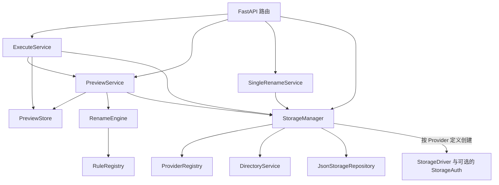
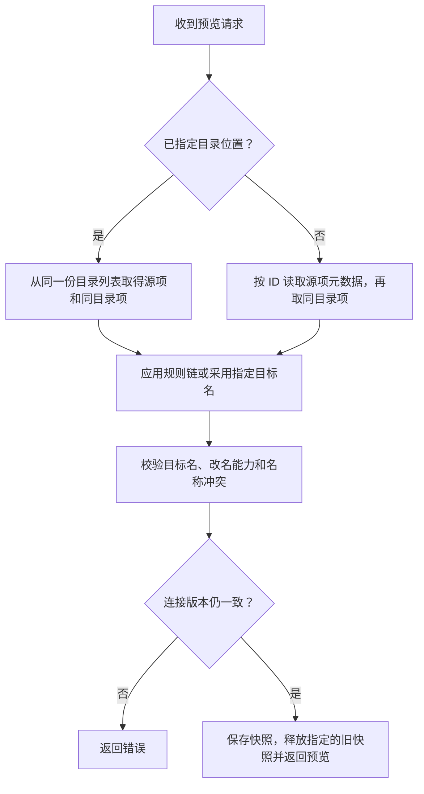
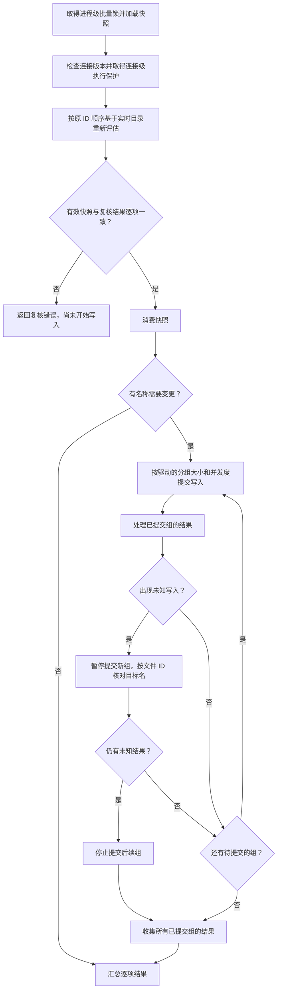
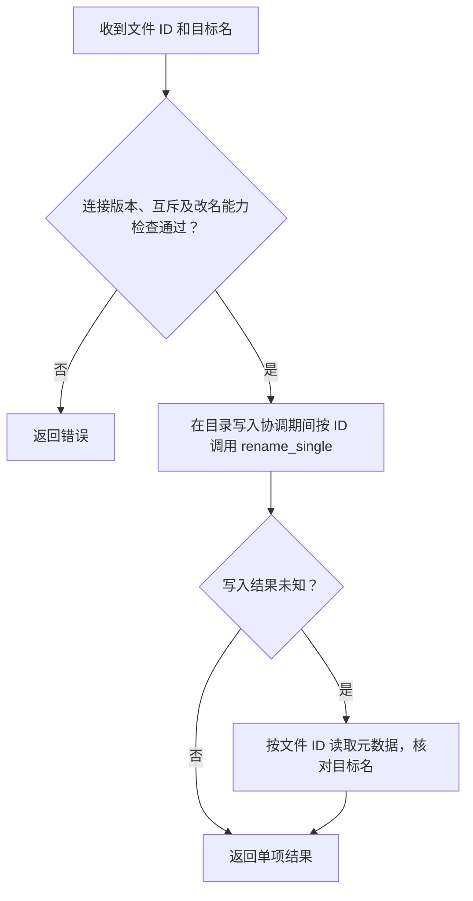

# 后端架构

[文档索引](../README.md) · [系统架构](../ARCHITECTURE.md) · [后端 Agent 指令](../../backend/AGENTS.md) · [前端架构](../frontend/ARCHITECTURE.md) · [测试与验收](TEST.md) · [API](../api/README.md)

章节：[代码地图](#代码地图) · [依赖与对象装配](#依赖与对象装配) · [预览与执行](#预览与执行) · [目录读取与缓存](#目录读取与缓存) · [持久化与部署](#持久化与部署) · [扩展入口](#扩展入口)

## 代码地图

| 入口 | 职责 |
| --- | --- |
| [main.py](../../backend/app/main.py) | FastAPI 创建、生命周期、请求日志上下文、统一异常响应 |
| [`api/router.py`](../../backend/app/api/router.py)、[storage_router.py](../../backend/app/api/storage_router.py)、[app_settings_router.py](../../backend/app/api/app_settings_router.py) | 共享、连接级和设置路由 |
| [`api/dependencies.py`](../../backend/app/api/dependencies.py) | 单进程共享服务装配、内置 Rule 与 Provider 注册 |
| [schemas](../../backend/app/schemas) | 输入输出、位置、配置、持久化状态和结果结构 |
| [StorageManager](../../backend/app/services/storage_manager.py) | 连接配置、revision、驱动与认证实例、OAuth 会话、身份、互斥、偏好与目录服务生命周期 |
| [ProviderRegistry](../../backend/app/providers/registry.py)、[builtin.py](../../backend/app/providers/builtin.py) | Provider 定义、配置模型校验与显式注册内置 Provider |
| [DirectoryService](../../backend/app/services/directory_service.py)、[DirectoryCache](../../backend/app/services/directory_cache.py)、[directory_metadata](../../backend/app/providers/directory_metadata.py) | 目录读取策略、并发请求合并、缓存与祖先索引、改名前后的缓存保护与更新 |
| [PreviewService](../../backend/app/services/preview_service.py)、[PreviewStore](../../backend/app/services/preview_store.py) | 评估源项/规则/冲突，保存与释放有期限、绑定 revision 的预览快照 |
| [RenameEngine](../../backend/app/services/rename_engine.py)、[rules](../../backend/app/rules) | 规则配置解析、顺序应用与带索引的 RuleContext |
| [ExecuteService](../../backend/app/services/execute_service.py) | 批量实时复核、快照消费、分组调度、进度与结果汇总 |
| [SingleRenameService](../../backend/app/services/single_rename_service.py)、[rename_write](../../backend/app/services/rename_write.py) | 单项直接执行、共享结果核对、写入取消后的收尾 |
| [StorageDriver](../../backend/app/providers/base.py)、[StorageAuth](../../backend/app/providers/auth.py)、[local](../../backend/app/providers/local)、[onedrive](../../backend/app/providers/onedrive)、[google_drive](../../backend/app/providers/google_drive) | 统一存储与授权接口及各 Provider 实现 |
| [core/errors](../../backend/app/core/errors.py)、[providers/errors](../../backend/app/providers/errors.py)、[retry](../../backend/app/providers/retry.py)、[cooldown](../../backend/app/providers/cooldown.py) | 应用错误、第三方诊断解析、重试预算和连接级限流等待 |
| [JsonStorageRepository](../../backend/app/repositories/storage_repository.py)、[core/config](../../backend/app/core/config.py)、[core/paths](../../backend/app/core/paths.py) | JSON 原子保存、环境/缓存配置、本地路径边界 |
| [release.py](../../backend/app/release.py)、[launcher.py](../../backend/app/launcher.py) | 静态资源组装、发布服务启动和退出 |

## 依赖与对象装配

路由通过 [`dependencies.py`](../../backend/app/api/dependencies.py) 获取进程内共享对象。图中的箭头从使用方指向依赖。

- **重命名服务**共用一个 `StorageManager`，从中获取连接 revision、Provider 定义、驱动和目录服务。批量与单项执行共用连接级执行锁。预览和批量执行共用快照库，名称转换由 `RenameEngine` 应用已注册的规则。
- **连接装配**显式注册内置 Provider，并通过 `ProviderRegistry` 校验连接配置。装配入口在首次启动时写入默认连接 `default-local`，后续启动时校验已保存的连接。默认连接定义也用于恢复出厂设置和删除保护。`JsonStorageRepository` 负责读取、结构校验和原子保存。应用退出时由 `StorageManager` 关闭驱动。
- **OAuth 授权**由路由接收授权请求和回调，并交给 `StorageManager`。它把 Provider 返回的 `state` 绑定到连接和 revision，回调时一次性消费会话，然后检查有效期、revision 和忙碌状态。Provider 负责 PKCE 和令牌交换，路由负责 HTTP 响应和回调页。

## 预览与执行

批量执行从预览快照开始。单项直接执行接收文件 ID 和目标名。两条路径共用连接互斥和未知结果核对机制。

### 预览

规则配置每轮解析一次，`RuleContext` 按请求中的 ID 顺序构造。名称变更时，按驱动的名称比较规则检查重复目标和同目录占用。同批待改名项目也计入占用，互换名称会被判为冲突。原样保留的名称允许已有重名。

预览只读文件。快照记录请求、源元数据、结果、连接 revision 和过期时间。校验发现无效项目时仍可保存快照并返回逐项结果。快照生命周期见[预览 API](../api/previews/index.md)。

### 批量执行

复核用 `mode="verify"` 实时读取原目录的全部直接子项。复核失败标记 `execution_started: false`。即使请求取消，执行保护也会保留到已发出的写入收尾。成功项保留，因未知结果而未提交的项目标记为 `not_attempted`。逐项状态与进度见[执行 API](../api/executions/index.md#execution-outcomes)。

### 单项直接执行

名称和存储边界由 Schema 与驱动按[单项契约](../api/executions/single.md)检查。Google Drive 即使收到与文件当前名称相同的目标名，也会按 ID 发送 `PATCH`。若目标名与其他项目重名，以 Google Drive 的返回结果为准。结果仍无法确认时保留 `unknown`。

## 目录读取与缓存

浏览请求参数在路由中转换为内部模式；精确参数见[目录 API](../api/directories/list.md)。

| 内部模式 | 用途与读取 | 缓存关系 |
| --- | --- | --- |
| `cached` | 普通浏览，可复用目录列表、父目录提示及已知祖先 | 按 Provider 能力、授权与连接 revision 使用缓存。同一连接、版本和目录位置的并发请求可共用一次读取，前提是读取开始后缓存代次未推进 |
| `refresh` | 手动刷新，或写入结果未知时由前端重读原目录。实时读取目录内容并核验目录关系 | 绕过旧读取结果和祖先缓存，成功后协调并更新缓存 |
| `navigate` | 外部导航时实时读取目录内容。目录名称和父级关系可来自缓存 | 对应 `refresh: true, reuse_ancestors: true` |
| `verify` | 批量执行前仅取实时完整子项；云盘按目录 ID 读取，不取目标/祖先元数据 | 不读写目录缓存，不复用祖先，不合并普通缓存读取 |

云盘驱动负责把分页完整取回。`verify` 可能因目录为空、不存在或权限隐藏而取得空成功响应；服务继续核对源 ID 并比较快照，源项缺失时拒绝执行。

目录列表以连接、revision、规范位置隔离，使用 cachetools 的过期/LRU 管理；祖先索引来自缓存列表，生命周期随列表维护。容量和 TTL 见[配置源](../../backend/app/core/config.py)与 [cache.toml](../../backend/cache.toml)，不另维护尺寸/默认值副本。

缓存代次是每个连接的计数器。开始写入、强制刷新或实时导航时推进代次，只有当前代次的读取结果可以写入缓存。改名期间，旧列表留作更新缓存的依据，普通浏览请求直接读取存储。写入结束后，服务用已确认的元数据更新缓存。结果未知或文件位置不明时，使受影响的缓存失效。执行异常中断时，使该连接的目录缓存失效。修改此处时同时检查前端 Query 缓存失效和未知结果核对流程。

## 持久化与部署

`StorageManager` 构造新状态，Repository 原子保存成功后才发布到内存；连接配置、授权身份变化会驱动 revision 与缓存/实例失效，同账号令牌轮换保留身份语义。状态文件包含未加密凭据，对外 `StorageInfo` 不返回凭据，只返回必要状态及密钥是否存在。

预览、进度、锁和缓存均保存在单个进程内，重启后丢失。后端按单 worker 部署。开发入口是 `app.main:app`，发布入口通过 `release.py` 同时提供静态页面、根路径 API 与 `/api`。相关操作见[开发启动](../DEVELOPMENT.md#环境与开发启动)、[发布包启动](../../README.md#启动)和[发布流程](../DEVELOPMENT.md#发布流程)。

## 扩展入口

| 扩展 | 代码入口 | 关联契约与调用方 |
| --- | --- | --- |
| Rule | [RenameRule](../../backend/app/rules/base.py)、具体规则/配置、[RuleRegistry](../../backend/app/rules/registry.py)、[依赖装配](../../backend/app/api/dependencies.py) | [规则 API](../api/rules/index.md)、[前端 RuleFields](../../frontend/src/features/rules/RuleFields.tsx)及语言词条 |
| Provider | [ProviderDefinition / Registry](../../backend/app/providers/registry.py)、[builtin](../../backend/app/providers/builtin.py)、具体配置/认证/Driver、[StorageDriver](../../backend/app/providers/base.py) | [Provider API](../api/providers/index.md)、前端字段/能力适配，必要时扩展浏览器导航适配器 |

Rule 接收调用方给定的 RuleContext，不访问存储或自行排序；序列编号使用输入顺序。Provider 负责位置、完整分页、名称约束、认证、错误与读写策略；核心 Service 通过统一接口复用这些能力。接口扩展需要同步所有实现与直接调用方，跨端字段同步 Schema、[前端类型](../../frontend/src/types/index.ts)及[客户端](../../frontend/src/api/client.ts)。
