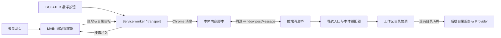

# 浏览器扩展架构

[文档索引](../README.md) · [扩展 README](README.md) · [扩展开发](DEVELOPMENT.md) · [系统架构](../ARCHITECTURE.md) · [前端架构](../frontend/ARCHITECTURE.md)

章节：[架构边界](#架构边界) · [模块与依赖](#模块与依赖) · [网站适配与身份](#网站适配与身份) · [导航流程](#导航流程) · [消息与生命周期](#消息与生命周期) · [安全与业务约束](#安全与业务约束) · [修改与扩展](#修改与扩展)

Rename Studio Browser 是本体的外部导航入口。扩展从云盘网页提取有界的账号和目录目标，通过浏览器消息交给工作台；工作台匹配已有连接，使用原有目录 API 完成授权检查、实时读取和显示。扩展不持有本体凭据，不调用重命名接口，也不另建导航 HTTP 端点。

本文按职责、依赖和业务约束组织，编写方式参考 [Dify 后端架构](https://github.com/langgenius/dify/blob/main/docs/BACKEND_ARCHITECTURE.md)，描述本项目当前实现。消息类型与精确字段校验链接到双方代码；安装使用见 README，环境、验证与发布见 DEVELOPMENT。

## 架构边界

扩展采用 Manifest V3、原生 JavaScript 和 DOM，使用 Material Web 组件及 Chrome i18n。浏览器环境分工如下：

- **MAIN 页面环境**：按需读取网站上下文。网站提取器只返回目标数据，不决定本体连接或执行本体业务。`material-main.js` 只注册界面组件。
- **ISOLATED 内容脚本**：云盘侧负责按钮和提示，本体侧负责消息转发；不从隔离环境读取网页全局变量。
- **Service worker**：核对来源、发现本体标签页、调用已注册的提取器、投递目标和关联回执。它不解释连接、目录权限或重命名状态。
- **前端导航与工作区**：导航适配器处理身份和范围规则，工作区统一负责查询、取消、缓存、位置记忆和显示完成。
- **后端 Provider**：使用本体已有授权读取云盘，保持原有目录类型、归属和权限约束。网页提取结果不是权限证明。

## 模块与依赖

| 代码入口 | 职责与依赖边界 |
| --- | --- |
| [manifest.json](../../extensions/browser/manifest.json) | 网站范围、权限、执行环境与脚本入口；运行时仍须精确核对 origin |
| [website-content.js](../../extensions/browser/src/website-content.js)、[floating-button.js](../../extensions/browser/src/floating-button.js) | 挂载按钮、发起点击请求、展示接收与最终结果；不承载网站身份解析 |
| [扩展 adapters](../../extensions/browser/src/adapters/index.js) | 显式注册网站 origin、请求类型、提取函数及载荷校验；网站差异留在各自适配器 |
| [service-worker.js](../../extensions/browser/src/service-worker.js)、[transport.js](../../extensions/browser/src/transport.js) | 来源检查、标签页发现、MAIN 注入、投递、超时与激活；通过注册表分发网站差异 |
| [workspace-content.js](../../extensions/browser/src/workspace-content.js) | Chrome 消息与页面消息桥接，关联文档实例并校验页面回复；不匹配账号 |
| [扩展 protocol.js](../../extensions/browser/src/protocol.js) | 命名空间、请求分发与回复边界；具体请求字段委托网站适配器 |
| [前端 protocol.ts](../../frontend/src/integrations/browser/protocol.ts)、[browserBridge.ts](../../frontend/src/integrations/browser/browserBridge.ts) | 校验网页消息与请求，处理就绪探测和单次通信；不直接访问目录 API |
| [navigation.ts](../../frontend/src/integrations/browser/navigation.ts)、[前端 adapters](../../frontend/src/integrations/browser/adapters/index.ts) | 进程内导航入口、Provider 能力筛选、唯一账号匹配、目标和列表校验 |
| [useBrowserNavigation](../../frontend/src/integrations/browser/useBrowserNavigation.ts) | 将导航入口接入工作台，检查业务占用及未知写入保护，生成业务回执 |
| [useWorkspaceStorage](../../frontend/src/workspace/hooks/useWorkspaceStorage.ts) | 打开目标、核对连接版本和账号、实时查询、显示完成、取消及位置恢复；不含网站提取逻辑 |

扩展与本体通过消息交互，不互相导入源码。扩展内部通用入口依赖网站注册表，本体通用导航依赖本体适配器；`WorkspaceApp` 负责接线，工作区通过目标对象的账号匹配和列表校验方法使用适配器规则。两侧校验实现独立，变更消息时须同步维护。

## 网站适配与身份

| 网站 | 提取器负责 | 本体适配器负责 |
| --- | --- | --- |
| OneDrive 个人版 | 从页面上下文取得 CID，在“我的文件”范围内使用同源只读接口把网页路径解析为真实目录 ID；子目录必须取得 drive ID，拒绝快捷方式和未验证范围 | 依据 `onedrive_personal` 能力筛选连接，以 CID 唯一匹配 `account_id`；核对目录 ID 和 drive ID，缺少 drive ID 时只接受后端确认的根目录 |
| Google Drive | 从 My Drive 根目录或普通子目录 URL 取得位置，从可见账号入口标签取得邮箱；拒绝 `resourcekey` 链接 | 依据 `google_drive_my_drive` 能力筛选连接，以去空白、转小写后的邮箱唯一匹配；之后按稳定 `account_id` 与 revision 保护会话，核对根位置或目录 ID |

OneDrive 的 CID 只按明确的 16 位十六进制身份比较，忽略字母大小写并保留前导零；提取器不猜测纯数字 `userCid` 的进制。邮箱、姓名和目录名称不用于替代 CID 匹配，不从 CID 构造 `storage_id` 或 `drive_id`。

Google Drive 的 `/u/{数字}` 只标识网页路径形状，不能作为本体账号身份。邮箱来自网站界面而非授权证明；后端 [Google Drive Provider](../../backend/app/providers/google_drive/driver.py) 仍核验目录类型、权限及 My Drive 归属。

两侧适配器和精确输入限制分别位于扩展的 [OneDrive](../../extensions/browser/src/adapters/onedrive.js)、[Google Drive](../../extensions/browser/src/adapters/google-drive.js)，以及本体的 [OneDrive](../../frontend/src/integrations/browser/adapters/onedrive.ts)、[Google Drive](../../frontend/src/integrations/browser/adapters/googleDrive.ts)。网页提取细节见 [OneDrive 提取器](../../extensions/browser/src/adapters/onedrive-page.js)与 [Google Drive 提取器](../../extensions/browser/src/adapters/google-drive-page.js)；它们依赖第三方页面结构，网站升级可能要求适配。

## 导航流程

1. 用户点击按钮，扩展生成 `request_id`。worker 检查扩展身份、顶层 frame、普通窗口、已注册网站 origin 和来源 documentId，同一来源标签页的重复请求直接拒绝。
2. 先发现唯一就绪的本体页，再读取网站目标。没有就绪页或存在多个就绪页时不提取、不自动新建标签页。探测发送失败时，可向已打开的本体页注入内容脚本并重试一次，以恢复安装或重载后的通信。
3. worker 在来源文档的 MAIN 环境运行已注册提取函数，检查结果、请求类型和请求 ID，并核对来源 URL 与文档身份。OneDrive 提取器还在异步读取期间监视页面上下文；页面或账号变化时丢弃结果。
4. 目标通过本体内容脚本交给前端。消息桥完成边界解析后，导航入口检查任务占用、待核对写入和唯一连接匹配；工作区同步保留本次操作，随后回复 `accepted`。worker 据此激活本体标签页和窗口。
5. 工作区复用连接列表与授权查询缓存；目标没有授权缓存时由普通授权查询初始化。外部目标优先于历史恢复位置，离开旧目录时释放预览、清理选择和任务，保留规则及未知写入保护。
6. 工作区通过[目录 API](../api/directories/list.md)发送 `refresh: true, reuse_ancestors: true`，实时读取目标元数据和内容；服务端可复用祖先索引。外部查询使用独立的 query key，以本次响应核对 `storage_id`、revision、规范位置及适配器范围。
7. 校验通过后接入普通目录缓存，使用后端规范位置显示并保存最后成功位置，才回复 `opened`。手动切换、连接版本或账号变化、重置及卸载取消旧操作，迟到响应不能影响新上下文。

目录读取失败时保留真实错误和已有成功位置记忆，不静默回根目录。保留目标的手动重试仍经过同一范围校验。外部导航不改写连接的默认目录；缓存与位置记忆的总体职责见[前端架构](../frontend/ARCHITECTURE.md#依赖与状态归属)。

## 消息与生命周期

消息命名空间为 `rename-studio.browser.v1`，消息版本独立于本体和扩展的软件版本。当前请求类型是 `open-onedrive-folder` 与 `open-google-drive-folder`；[前端类型](../../frontend/src/integrations/browser/types.ts)及两侧适配器定义具体载荷，双方边界拒绝额外字段、非法字符串和不支持的版本或类型。

Chrome 消息用于网站、worker、本体内容脚本之间；内容脚本与应用之间使用同源 `window.postMessage`。`probe` / `ready` 确认业务入口已挂载，`navigate` / `navigation-reply` 承载目标与回复。每次回复关联原 `request_id`，`instance_id` 绑定本体内容脚本文档；后者是关联标识，不是认证凭据。

| 结果 | 含义 |
| --- | --- |
| `accepted` | 本体已接收业务请求并保留操作，可激活其标签页；随后读取并校验目标目录 |
| `opened` | 目标目录经实时读取、范围校验并完成显示，带本体 `storage_id`；只有它表示跳转成功 |
| `rejected` | 明确拒绝或业务失败，带结构化 `code`；不以提示文字推断状态 |
| `result_timeout` | 投递后失联或超时，导航结果待核对；先查看本体当前目录 |

通信采用一次最终响应和单独的接收事件，不使用持久队列或自动重放。worker 与内容脚本只在内存中保存当前请求；完成、超时或来源关闭后清理。桥接超时只清理通信状态，业务取消由工作区管理。具体时限由 [transport](../../extensions/browser/src/transport.js)、[内容脚本](../../extensions/browser/src/workspace-content.js)和[前端消息桥](../../frontend/src/integrations/browser/browserBridge.ts)维护。

提取错误、传输错误和本体导航错误各自保留语义：范围无法确认时拒绝导航；账号不匹配不自动授权；重复请求不排队；目录 API 的现有错误码直接保留，不统一改成“目录不存在”。消息版本或请求类型不兼容时明确拒绝，不猜测或降级到另一网站。

## 安全与业务约束

- 发布版只连接 `http://localhost:8000`，开发版只连接 `http://localhost:5173`。Chrome host/match pattern 不能限制端口，因此 worker、内容脚本和应用消息桥必须核对准确 origin，不扫描端口。
- 权限仅包含 `scripting` 和 manifest 明确列出的 OneDrive、Google Drive、localhost host 范围。不申请 `all_urls`、`cookies`、`debugger`、`webRequest`、`activeTab` 或 `tabs` 权限。
- 页面桥核对 source、origin、方向、命名空间、版本和请求关联。同源页面脚本也可发送消息，因此桥只接受有界导航意图；账号、授权、目录范围和业务保护由本体校验。
- 只有点击时提取目标；网页凭据只用于 OneDrive 同源只读查询。消息不携带 Token、Cookie、原始页面上下文、任意 API URL、文件列表、规则或脚本，不持久化账号、目录及原始响应日志。
- 导航不新增连接、不自动授权、不选择文件、不发起预览或写入，不绕过任务占用、连接 revision、账号身份或未知写入保护。
- 边界各负其责：worker 校验 MAIN 提取结果，前端校验页面请求，本体内容脚本校验页面回复；内部已经收敛的载荷不重复完整校验，仍保留来源和请求关联检查。

## 修改与扩展

新增网站需同时增加扩展网站适配器、来源权限、本体请求类型和导航适配器，并在后端 Provider 定义中声明对应导航能力。共用 worker、消息桥和工作区继续只依赖注册表与目标契约，不在其中追加网站专用身份分支。

修改网页提取时核对来源、账号、范围和页面变化场景；修改消息时同步双方校验、类型与回归；修改本体接入时保留实时读取、显示完成、取消、重试和未知写入约束。验证入口见[扩展开发](DEVELOPMENT.md#验证)，HTTP 字段继续由 [API 文档](../api/README.md)维护。
