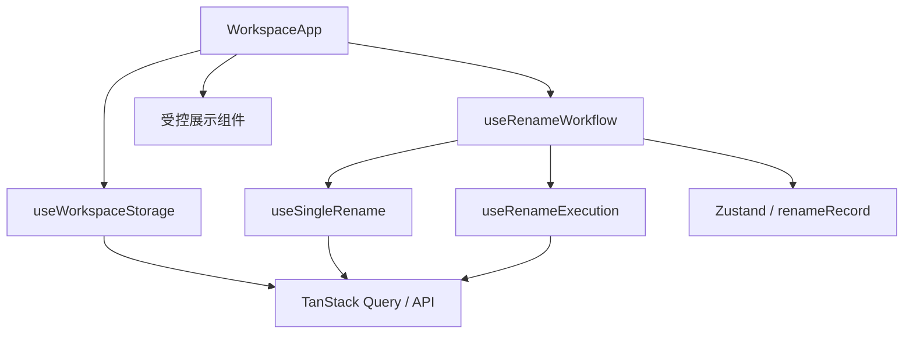

# 前端架构

[文档索引](../README.md) · [系统架构](../ARCHITECTURE.md) · [前端 Agent 指令](../../frontend/AGENTS.md) · [UI 设计](UI_DESIGN.md) · [测试与验收](TEST.md) · [API](../api/README.md)

章节：[代码地图](#代码地图) · [依赖与状态归属](#依赖与状态归属) · [核心流程](#核心流程) · [扩展位置](#扩展位置)

## 代码地图

下列入口均链接到实际实现；测试入口与验收方法见[TEST.md](TEST.md)。

| 入口 | 职责 |
| --- | --- |
| [main.tsx](../../frontend/src/main.tsx)、[App.tsx](../../frontend/src/App.tsx)、[WorkspaceApp.tsx](../../frontend/src/WorkspaceApp.tsx) | QueryClient、应用入口、Provider 组合、布局、工作区/设置内存视图及导航保护；没有 URL 路由 |
| [useWorkspaceStorage](../../frontend/src/workspace/hooks/useWorkspaceStorage.ts)、[workspaceSession](../../frontend/src/workspace/workspaceSession.ts) | 连接与目录查询、位置恢复、目录选择、刷新和标签会话记忆 |
| [useRenameWorkflow](../../frontend/src/features/rename/useRenameWorkflow.ts) | 有序有效选择、批量预览生命周期、单项与批量协调、未知结果门控 |
| [useRenameExecution](../../frontend/src/features/rename/useRenameExecution.ts)、[useSingleRename](../../frontend/src/features/rename/useSingleRename.ts) | 独立的批量/单项请求、结果合并、错误和未知结果保护 |
| [renameRecord](../../frontend/src/features/rename/renameRecord.ts)、[useRenameStore](../../frontend/src/stores/useRenameStore.ts) | 提交与最近逐项记录、确认元数据、选择、规则和独立待核对信息 |
| [FileBrowser](../../frontend/src/features/files/FileBrowser.tsx)、[LocationBreadcrumbs](../../frontend/src/features/files/LocationBreadcrumbs.tsx)、[fileSort](../../frontend/src/features/files/fileSort.ts) | 文件表、完整集合的排序/筛选/选择、目录导航 |
| [RuleEditor](../../frontend/src/features/rules/RuleEditor.tsx)、[RuleFields](../../frontend/src/features/rules/RuleFields.tsx) | 顺序规则链和显式字段编辑器 |
| [PreviewPanel](../../frontend/src/features/rename/PreviewPanel.tsx)、[RenameActions](../../frontend/src/features/rename/RenameActions.tsx)、[RenameActionsWithProgress](../../frontend/src/features/rename/RenameActionsWithProgress.tsx)、[SingleRenameDialog](../../frontend/src/features/rename/SingleRenameDialog.tsx) | 预览/结果展示、执行确认、局部进度订阅与单项输入 |
| [StorageSidebar](../../frontend/src/workspace/components/StorageSidebar.tsx)、[StorageLocationPanel](../../frontend/src/workspace/components/StorageLocationPanel.tsx) | 连接侧栏与目录工具栏；Drawer 由工作台容器管理 |
| [SettingsPage](../../frontend/src/features/settings/SettingsPage.tsx)、[StorageSettingsPanel](../../frontend/src/features/settings/StorageSettingsPanel.tsx) | 外观、语言、多连接配置与授权交互 |
| [useAppSettings](../../frontend/src/features/settings/useAppSettings.ts)、[useThemePreference](../../frontend/src/features/settings/useThemePreference.ts)、[useFactoryReset](../../frontend/src/workspace/hooks/useFactoryReset.ts) | 串行保存偏好、主题订阅及恢复出厂后的协调清理 |
| [api/client.ts](../../frontend/src/api/client.ts)、[types](../../frontend/src/types/index.ts) | HTTP 客户端、连接级请求、跨端类型与结构化错误 |
| [i18n](../../frontend/src/i18n)、[locales](../../frontend/src/locales) | 语言发现/加载/偏好、错误展示与本地化资源 |
| [browser integration](../../frontend/src/integrations/browser) | 消息桥、Provider 适配器、外部导航接入；边界与流程见[扩展架构](../browser-extensions/ARCHITECTURE.md) |
| [components](../../frontend/src/components)、[useVirtualTable](../../frontend/src/hooks/useVirtualTable.ts)、[theme](../../frontend/src/theme.ts)、[styles](../../frontend/src/styles.css) | 共享控件、通知、虚拟化、主题和布局 |

## 依赖与状态归属

`WorkspaceApp` 显式传递两个主 Hook 所需的数据和重置动作；连接 Hook 与重命名 Hook 不直接互相调用。展示组件通过 props 和回调交互，不承载跨模块状态机。

| 数据 | 所属位置 | 约束 |
| --- | --- | --- |
| 连接、Provider 能力、授权、目录、偏好 | TanStack Query | Query key 隔离连接、revision 与位置；读取错误与授权状态分别处理 |
| 选择、规则、执行中的提交、最近记录、待核对信息 | Zustand | 不与目录缓存或展示筛选混为一份状态 |
| 批量预览版本、请求上下文、单项编辑会话 | 工作流 Hook | 迟到响应必须核对上下文；失效预览不能因输入改回而复活 |
| 文件排序、工作区/设置视图 | 工作台页面内存 | 排序显式传给表格与工作流，不修改 Query 缓存 |
| 文件与预览筛选、局部弹窗草稿 | 对应组件/功能 Hook | 展示筛选不能改变批量执行范围 |
| 最近成功目录 | sessionStorage | revision、账号匹配后才恢复；不保存选择、预览、凭据或结果 |

## 核心流程

### 连接与目录

先取得 Provider 元数据，再依据 `browser_auth`、`local_picker`、`locations` 等能力处理授权和目录，不通过服务名猜能力。有效标签会话位置优先于账号默认云目录，恢复就绪前暂停目录查询。旧连接/账号响应不能覆盖当前位置。

普通导航可携带已知父位置。手动刷新与未知结果核对请求 `refresh: true`；外部导航请求 `refresh: true, reuse_ancestors: true`，实时读取内容并保留目标核验。完整刷新发现结构变化时清理同连接版本的其他目录查询及待完成请求。目录读取时禁止目录导航与重复刷新，仍允许切换连接；写入在途时另有导航与自动读取保护。参数语义见[目录 API](../api/directories/list.md)。

### 选择、预览与执行

完整目录先排序，再筛选和虚拟化。选择先后不决定提交顺序；`useRenameWorkflow` 从排序后的完整目录取得可改名的选中项。文件筛选清除隐藏项的选择，取消筛选不恢复；刷新成功后选择取交集，失败保留。全选/反选作用于完整可见且可选择集合。

连接、账号、revision、目录、选择、规则、排序或选中项名称变化后，旧预览不可执行；替换、切换与迟到响应按生命周期释放快照。预览筛选仅影响展示。批量执行经确认后提交 `preview_id`，结果使用服务端逐项状态，进度局部订阅且不触发重复执行。

单项有独立请求和 `operation_id`，打开/取消不清除批量预览，提交时使其失效。成功只合并确认元数据，兼容 Local ID 改变。文件移走或明确不存在时移除旧项；归属不明时重新读取，不能直接当作未知写入。完整执行约束见[系统架构](../ARCHITECTURE.md#核心流程)和[单项契约](../api/executions/single.md)。

### 修改记录与未知结果

提交信息、最近修改记录与预览分开管理：服务端明确在写入前拒绝时保留上一条记录；收到逐项结果或无法确认写入时记录本次结果。迟到结果归发起操作的连接与目录，不污染当前展示。

未知、缺失结果或单项成功但缺少确认元数据时建立待核对保护，阻止新的预览和写入。切换工作区保留该保护；原目录强制读取成功后解除门控，最近记录保留，旧预览仍不可执行。不按名称补造文件身份或结果。

### 设置与语言

偏好由后端持久化，`useAppSettings` 在同一 QueryClient 内串行保存修改字段，失败不阻断后续请求，成功才更新缓存。主题 `system` 与语言 `auto` 保留偏好语义，不将解析结果写回。语言加载不重挂载工作台，不改变选择、规则或执行记录。

### 连接设置与授权

[StorageSettingsPanel](../../frontend/src/features/settings/StorageSettingsPanel.tsx) 根据 Provider `config_fields`、字段 `target` 和能力渲染配置与操作。元数据或授权读取失败不等同于未授权。本地选择器运行在后端机器：新增连接时只填草稿，已有连接选择根目录则立即保存。

OAuth 完成由回调或授权状态查询确认，校验 origin、source、消息结构及连接身份；弹窗关闭后继续查询授权状态，等待期间可取消。发起/回调失败在面板 Alert 展示，重复绑定错误提示已有连接，成功沿用统一通知。

密钥通过允许的顶层请求字段提交，响应只表示是否已保存；编辑留空保留旧值，保存成功、关闭或切换新增类型后清理草稿，失败保留。连接 Dialog 保存后保持打开，关闭只丢弃未保存草稿；默认 Local 禁止删除，删除配置/授权不删除文件。通用交互要求见 [UI 规范](UI_DESIGN.md#交互设计规范)。

### 文案与错误

固定 UI、通知、Tooltip 和 ARIA 使用 `react-i18next`，默认/回退为 en-US，同时维护 zh-CN；模块常量和通知保留键及参数，到展示时翻译。Rule 文案按 `rules:types.<type>`、Provider 字段按 `providers:<provider_type>.fields.<key>` 定位。文件名、路径、连接名、账号与规则输入值保持用户数据，不用 JSON Schema 的 title/description 代替 UI 词条。

语言通过 `meta.json` 与命名空间文件发现，社区语言缺词回退英文，必要文件结构仍需完整。检查器入口是 [check-i18n.mjs](../../frontend/scripts/check-i18n.mjs)，动态键、MUI 自带文案和实际布局仍由浏览器验收。贡献步骤见[翻译指南](https://github.com/runoobjerry/Rename_Studio/wiki/Contribute-translations)与[Agent 版指南](https://github.com/runoobjerry/Rename_Studio/wiki/Contribute-translations-(Agents))。

错误链路为 [API client](../../frontend/src/api/client.ts) → [errorPresentation](../../frontend/src/i18n/errorPresentation.ts) → [messages](../../frontend/src/i18n/messages.ts) → 词典。展示层依据应用错误码、结构化原因和结果确定性选择提示，不负责重试或执行状态转换；后端原始 message 保留诊断用途，不直接当作 UI 提示。`errorMessage(error, t, context)` 与通知的 `errorContext` 使用 `ErrorPresentationContext` 声明的场景；插值仅接受允许的展示字段，不把用户数据作为 i18next 配置。契约见[共享错误](../api/common/errors.md)。

## 扩展位置

- 新规则：后端注册与 [API](../api/rules/index.md)同步；前端在 `RuleFields` 显式适配，不从 JSON Schema 自动生成完整表单。
- 新 Provider：通用 UI 读取元数据与能力；新增字段类型或外部导航适配器时再扩展对应边界，见[后端扩展入口](../backend/ARCHITECTURE.md#扩展入口)。
- 共享 UI：先复用组件和主题；局部变化留在对应功能，遵循 [UI_DESIGN](UI_DESIGN.md)。
